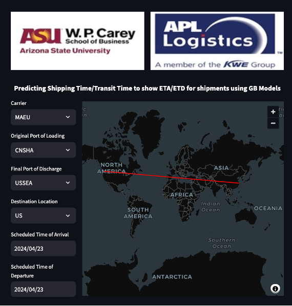
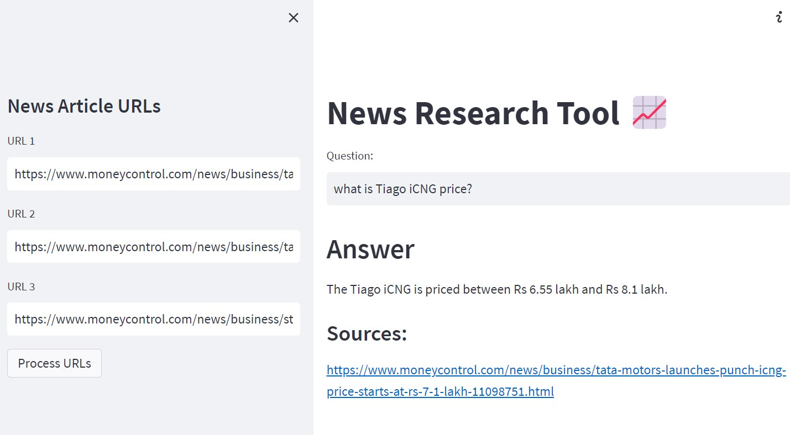
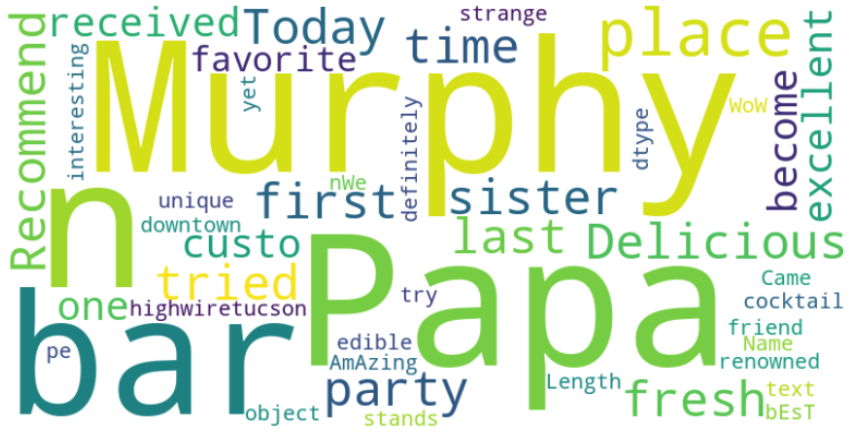
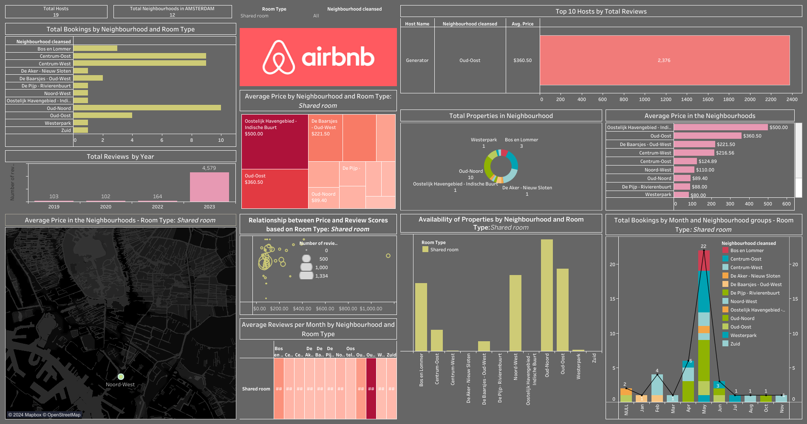

<h2 id="about">About</h2>

I build the layer between raw data and decisions. On the data engineering &amp; analytics team at a consumer fintech, I design <b>master tables and datamarts</b> that serve as a single source of truth, turn business metric definitions into <b>governed SQL</b>, and ship <b>tested Airflow pipelines through CI/CD</b>. I use Claude Code daily and design models and documentation that both analysts and AI agents can rely on.

I came to data from petroleum engineering (IIT-ISM Dhanbad), where SQL, Python, and Tableau helped cut drilling costs by over $3M. I then earned an M.S. in Business Analytics at Arizona State University's W. P. Carey School of Business (GPA 4.0).

  
1,000+employees on the scorecard I built

  
50+KPIs governed in one data model

  
$3M+cost savings from analytics

  
5+ yrsworking with data

Open to Analytics Engineering roles: remote (US) or relocation.

<h2 id="experience">Experience</h2>

  
<strong>Data Analyst II – Data Engineering &amp; Analytics</strong>Feb 2026 – Present

  
Upgrade Inc. (consumer fintech: lending, cards &amp; banking) · Phoenix, AZ

  <ul>
    <li>Designed <b>master tables</b> and a <b>datamart</b> for conversation, QA, and customer-satisfaction data on top of Data Engineering's source tables, with <b>incremental loads</b>, creating the single source of truth for contact-center metrics.</li>
    <li>Built the <b>Contact Center Scorecard</b> for 1,000+ employees: DAGs turn 50+ KPIs into events, goals, and scores in <b>dim/fact tables</b>, with tests shipped through CI/CD. Reporting accuracy improved 20% and processing speed 70%.</li>
    <li>Built a <b>Claude data plugin</b> (skills, agents, context) that lets 7 analysts self-serve metric definitions and analysis.</li>
  </ul>

  
<strong>Data Analyst I – Data Engineering &amp; Analytics</strong>Jul 2024 – Jan 2026

  
Upgrade Inc. · Phoenix, AZ

  <ul>
    <li>Built Python/SQL pipelines into <b>Redshift</b> feeding a unified <b>semantic layer</b> and dimensional models for Tableau self-service.</li>
    <li>As the team's AI Champion, used Claude Code daily and built a <b>validation framework</b> (templates, guardrails, reconciliation tests) to keep metric logic consistent.</li>
    <li>Automated recurring workflows with Python, SQL, and APIs, saving 60+ hours per month.</li>
  </ul>

  
<strong>Drilling Engineer / Analyst</strong>Oct 2020 – Jul 2023

  
Cairn Oil and Gas · India

  <ul>
    <li>Used SQL and Python on operational data to build a predictive maintenance framework that <b>cut costs by over $3M</b>.</li>
    <li>Built Tableau dashboards for asset-level KPIs that drove a <b>10% gain in operational efficiency</b>.</li>
  </ul>

<h2 id="data-engineering">Data &amp; Analytics Engineering Projects</h2>

  

    <h3>Healthcare Medallion Pipeline</h3>
    
Databricks · Delta Live Tables

    
CSV → bronze → silver (quality checks) → gold

    
A Databricks pipeline that ingests daily patient files incrementally with streaming tables, drops invalid rows with declarative data-quality expectations, and publishes gold aggregate tables for reporting.

    
DatabricksDelta LakeDLTSQLPySpark

    
<a class="btn" href="https://github.com/shethbhumit/data-engineering/tree/main/Delta-Live-Tables-Healthcare-Pipeline-main">GitHub</a>

  

  

    <h3>Trade KPI Analytics</h3>
    
Snowflake · Dynamic Tables

    
raw trades → bronze → silver → gold KPIs

    
A medallion architecture on Snowflake Dynamic Tables with incremental refresh and scheduled tasks, publishing gold-layer trader, instrument, and strategy KPI tables.

    
SnowflakeDynamic TablesSQLPython

    
<a class="btn" href="https://github.com/shethbhumit/data-engineering/tree/main/RealTime-Trader-KPI-Analytics-main">GitHub</a>

  

  

    <h3>Car Rental Warehouse (SCD2)</h3>
    
Snowflake · Airflow · PySpark

    
daily files → MERGE (SCD2) → dims + fact

    
SCD2 dimension and fact tables with MERGE-based incremental upserts orchestrated in Airflow, surrogate keys for point-in-time history, and null/PK/FK data-quality checks.

    
SnowflakeAirflowSCD2Dimensional modeling

    
<a class="btn" href="https://github.com/shethbhumit/data-engineering/tree/main/Snowflake-car-rental-pipeline-SCD2-main">GitHub</a>

  

  

    <h3>News Data Pipeline</h3>
    
Airflow · GCS · Snowflake

    
News API → Parquet → staging → marts

    
An Airflow-orchestrated pipeline that pulls news articles from an API, lands them as Parquet in cloud storage, and loads them through staging into Snowflake tables for analysis.

    
AirflowSnowflakePython

    
<a class="btn" href="https://github.com/shethbhumit/data-engineering/tree/main/news-data-analysis-snowflake-pipeline-main">GitHub</a>

  

<h2 id="ai">How I Work with AI</h2>

<ul>
  <li><b>AI-assisted development, validated.</b> I use Claude Code every day for SQL and Python, backed by a validation framework (prompt templates, guardrails, reconciliation tests, review checklists) so AI-written logic is checked before anyone relies on it.</li>
  <li><b>Data built for humans and agents.</b> I built a Claude data plugin on our team's LLM-context repo, documenting models and metric definitions so analysts and AI agents get the same answers.</li>
  <li><b>Retrieval-augmented apps.</b> NewsPulse AI (below) answers questions about financial news using LangChain, OpenAI embeddings, and FAISS, with source links for every answer.</li>
</ul>

<h2 id="analytics-ml">Analytics &amp; Machine Learning Projects</h2>

  

    
    <h3>Shipment ETA/ETD Prediction (Master's Capstone)</h3>
    
2024 · Supply chain · Team of five

    
Led an end-to-end project that forecasts ocean shipment arrival and departure times: 54k shipments, 211 routes, 23 carriers. The best model reached an R² of 0.78 and was deployed as a Streamlit app.

    
PythonRandom ForestGradient BoostingStreamlitTableau

    

      <a class="btn" href="https://github.com/shethbhumit/APL_Logistics">GitHub</a>
      <a class="btn" href="https://drive.google.com/file/d/1dC38g5Nu6LL-6oYzVxkShD5fyHusjAlL/view?usp=sharing">Thesis (PDF)</a>
    

  

  

    
    <h3>NewsPulse AI</h3>
    
LLM · Retrieval-augmented generation

    
A news research tool: paste article URLs, then ask questions about financial and stock-market news. Articles are embedded with OpenAI, retrieved with FAISS, and answered with source URLs.

    
LangChainOpenAIFAISSPython

    
<a class="btn" href="https://github.com/shethbhumit/NewsPulse-AI">GitHub</a>

  

  

    
    <h3>Arizona Restaurant Reviews (Yelp)</h3>
    
NLP · Sentiment &amp; topic analysis

    
Analyzed Yelp reviews and ratings for Arizona restaurants with sentiment analysis, topic extraction, and regression/classification models to show how reviews relate to ratings over time.

    
spaCyNLTKBERTPython

    

      <a class="btn" href="https://github.com/shethbhumit/Yelp_Data_Analysis">GitHub</a>
      <a class="btn" href="https://drive.google.com/file/d/1Hs4JOmm4zj-vfQKhzWDXTLmvURVLgkEl/view?usp=sharing">Slides (PDF)</a>
    

  

  

    
    <h3>Amsterdam Airbnb Review Analytics</h3>
    
SQL · Tableau

    
Used SQL on <a href="http://insideairbnb.com/get-the-data/">Inside Airbnb</a> data to find what top Amsterdam hosts earn and who would be likely customers for an Airbnb cleaning business, then built an interactive Tableau dashboard.

    
SQLTableau

    

      <a class="btn" href="https://github.com/shethbhumit/airbnb_reviews_analytics">GitHub</a>
      <a class="btn" href="https://public.tableau.com/app/profile/bhumit.sheth/viz/DashboardAmesterdamAirbnb/Dashboard1">Tableau</a>
    

  

<h3>Earlier coursework</h3>
<ul class="coursework">
  <li><b>Auto insurance fraud detection</b>: Random Forest classifier tuned to reduce missed fraud cases. <a href="https://github.com/shethbhumit/Fraud-Detection-Using-Predictive-Analysis">GitHub</a></li>
  <li><b>Santander customer satisfaction (Kaggle)</b>: predicting dissatisfied bank customers with tree-based models. <a href="https://github.com/shethbhumit/Santander-Customer-Satisfaction">GitHub</a></li>
  <li><b>Homesite quote conversion</b>: comparing SVM, Random Forest, KNN, and MLP for policy purchase prediction. <a href="https://github.com/shethbhumit/Homesite_Quote_Conversion">GitHub</a></li>
  <li><b>Supply chain sustainability metrics</b>: delivery, profitability, and shipping-mode analysis in Python. <a href="https://github.com/shethbhumit/Sustainability_Metrics_in_Supply_Chain_with_Python-">GitHub</a></li>
  <li><b>Lean Six Sigma Green Belt (National Industries for the Blind)</b>: led a four-person team testing whether a "Matthew Effect" exists among nonprofit agencies. <a href="https://drive.google.com/file/d/1zS19Ui_P6ej4firtNUwpMHYCov5cqlDF/view?usp=sharing">Report (PDF)</a></li>
  <li><b>Iowa Business Analytics Case Competition (Ball Corporation)</b>: organizational-health strategy on turnover, safety, and efficiency. <a href="https://github.com/shethbhumit/IOWA_Business_Analytics_Case_Competition">GitHub</a> · <a href="https://docs.google.com/presentation/d/1kJqHRn8OLLJSNaeNrKCGpJRib4ynSFSc/edit?usp=sharing&amp;ouid=102975432456670625356&amp;rtpof=true&amp;sd=true">Slides</a></li>
</ul>

<h2 id="skills">Skills</h2>

<table class="skills">
  <tr><th>Modeling &amp; Transformation</th><td>SQL (CTEs, window functions), dimensional modeling (dim/fact, SCD2), medallion architecture, incremental loads (MERGE/upsert), data quality testing</td></tr>
  <tr><th>Platforms &amp; Orchestration</th><td>Databricks (Delta Live Tables, Delta Lake), Snowflake (Dynamic Tables), Redshift, PostgreSQL, Apache Airflow</td></tr>
  <tr><th>Engineering &amp; AI</th><td>Python, PySpark, Git/GitHub, CI/CD, Claude Code (daily), LangChain</td></tr>
  <tr><th>BI &amp; Analytics</th><td>Tableau, semantic layers, Excel, A/B testing, time series (SARIMA), regression, scikit-learn</td></tr>
  <tr><th>Currently learning</th><td>dbt (incremental models, tests, macros), Databricks semantic metrics</td></tr>
</table>

© {{ "now" | date: "%Y" }} Bhumit Sheth

